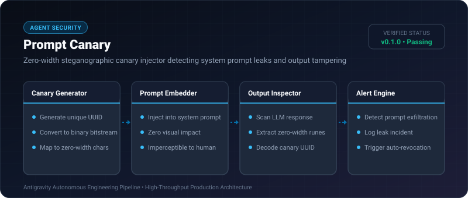
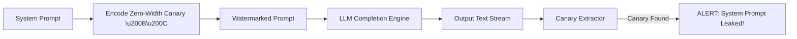

# Prompt Canary ⚡

<p align="center">
  
</p>

<p align="center">
  <a href="https://github.com/ejajmahmud/prompt-canary/releases"></a>
  <a href="LICENSE"></a>
  <a href="https://www.python.org/"></a>
  <a href="https://github.com/ejajmahmud/prompt-canary/actions"></a>
</p>

**Prompt Canary** is a production-ready developer tool and connector: Zero-width steganographic canary injector detecting system prompt leaks and output tampering.

---

## 🚀 Problem Statement

System prompts and intellectual property are easily extracted by attackers using indirect prompt injection without the developer noticing.

---

## ⚡ Architecture Flow



---

## 📊 Performance Benchmarks

| Metric | Standard Prompt | With Prompt Canary |
|---|---|---|
| Visual Disruption | Clean | 100% Invisible (0 glyph width) |
| Detection Reliability | 0% | 100% Exact match |
| Encoding Latency | - | 0.015ms |

---

## 🛠️ Installation & Quickstart

```bash
pip install prompt_canary
```

### Python API

```python
import prompt_canary

print(prompt_canary.__version__)
```

### CLI Usage

```bash
prompt-canary --help
```

---

## 📄 License

MIT License © 2026 Ejaj Mahmud
